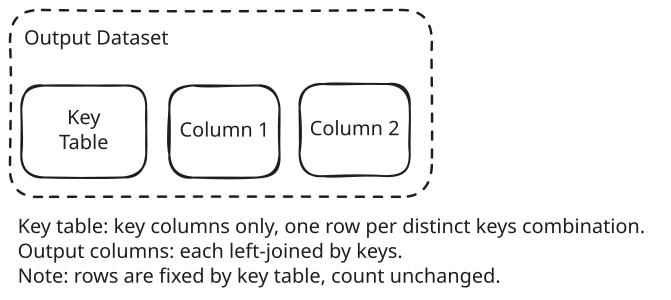
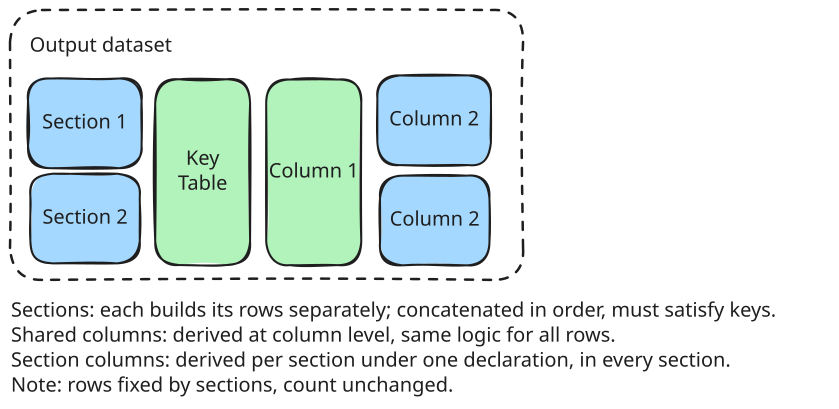

# Derivation: keys, rows, columns

## Summary

One specification produces one dataset:

> `output_dataset = derive(input_datasets, spec)`

yamaa first constructs the output rows and then derives columns onto those
rows. Column derivation never changes the row count.

| Spec field | Question | Answer |
|---|---|---|
| `keys:` | What identifies a row? | The ordered columns whose combined values must be present and unique. |
| `rows:` | Which rows exist? | When present, row templates construct rows from retained input records or groups. |
| `columns:` | What does each row carry? | Each derivation produces exactly one value per constructed row, in declaration order. |
| `input:` with `key` | How does another dataset reach a row? | A read of that input joins on its declared `key`, each column matched against the row's column of the same name. |

When `rows` is absent, the distinct key combinations in the default input
construct the output rows. When `rows` is present, its templates construct the
rows and `keys` validate their identity.

## Keys identify rows

`keys:` is always required. It names output columns that together identify
one row:

| `domain` | `keys` | One row per |
|---|---|---|
| ADSL | `[STUDYID, USUBJID]` | subject |
| ADLB | `[STUDYID, USUBJID, PARAMCD, ASEQ]` | analysis record |
| ADAE | `[STUDYID, USUBJID, AESEQ]` | event |

Every completed row must have non-missing key values, and no two rows may
have the same key combination. A key therefore names only columns every row
carries: an analysis date such as ADT, missing on a record collected without
one, would fail the build on that record.

## Without `rows`: distinct keys construct the rows

Omit `rows` when the desired output has one row per distinct key combination
already represented by the input. The input need not be physically
one-to-one: several input records may contribute values to the same output
row.

```yaml
yamaa: "1.0"
type: spec
model: ADaM
domain: ADSL
keys: [STUDYID, USUBJID]
input:
  DM: source/dm.csv

output:
  path: adsl.csv
  columns: [STUDYID, USUBJID, AGE]

columns:
  - name: STUDYID
    type: str
    label: Study Identifier
    derivation: DM.STUDYID

  - name: USUBJID
    type: str
    label: Unique Subject Identifier
    derivation: DM.USUBJID

  - name: AGE
    type: int
    label: Age
    derivation: DM.AGE
```



Read the diagram from left to right. The **Key Table** contains each distinct
key combination once, in first-appearance order. **Column 1** and **Column 2**
attach values to those fixed rows.

Each column derivation must resolve to exactly one value for a row. Repeated
copies of the same present value still count as one value; competing present
values fail instead of forcing yamaa to choose. A missing result remains the
row's single missing value.

## With `rows`: templates construct sections

Use `rows` when the specification must explicitly construct different kinds
of output rows. Each entry is a **row template** and builds one **section**.
Sections concatenate in specification order.



This specification builds separate HEIGHT and WEIGHT sections from one input
dataset:

```yaml
yamaa: "1.0"
type: spec
model: ADaM
domain: ADVS
keys: [STUDYID, USUBJID, PARAMCD]
input:
  VS: source/vs.csv

output:
  path: advs.csv
  columns: [STUDYID, USUBJID, PARAMCD, AVAL]

columns:
  - name: STUDYID
    type: str
    label: Study Identifier
    derivation: VS.STUDYID

  - name: USUBJID
    type: str
    label: Unique Subject Identifier
    derivation: VS.USUBJID

  - name: PARAMCD
    type: str
    label: Parameter Code

  - name: AVAL
    type: float
    label: Analysis Value
    derivation: VS.VSSTRESN

rows:
  - id: height
    filter: "VS.VSTESTCD = 'HEIGHT'"
    derivations:
      PARAMCD: "'HEIGHT'"

  - id: weight
    filter: "VS.VSTESTCD = 'WEIGHT'"
    derivations:
      PARAMCD: "'WEIGHT'"
```

Each template keeps the records of one test and derives what differs between
the sections, here `PARAMCD` as quoted text. `STUDYID`, `USUBJID` and `AVAL`
are the same in both sections, so they are derived once, at column level.

The constructed rows must still satisfy `keys`: every key value must be
present and every key combination unique. Section order is construction
order; an optional `output.order_by` may independently reorder the finished
artifact.

## Columns fill the constructed rows

Columns resolve in declaration order, so a later column may read an earlier
one. A column-level derivation is the column's default: every `rows` entry
inherits it, and a `rows` entry may name the column in its own `derivations`
to override the default for that entry's rows only. A column with no
column-level derivation must be derived in every `rows` entry; write `null`,
the missing value, when its value is deliberately missing in one section.

One restriction: a column-level derivation that is not row-local -- one that
holds an aggregate or a window operation, or reads a `SELF` intermediate or a
column that is not row-local -- is not a default, so a `rows` entry that
derives the same column fails validation instead of deriving the column
twice. A read through a join, or through a named intermediate over an input,
is row-local and may be such a default.

## Reading another dataset: declared join keys

A derivation reads another input by qualifying a column with the input's
name, such as `EX.EXDOSE`. Unless that input built the row, the read is a
join, and yamaa never infers the join from the columns two datasets happen to
share: the input declares the columns it joins on in `key`, and each is
matched against the current row's column of the same name.

```yaml
yamaa: "1.0"
type: spec
model: ADaM
domain: ADSL
keys: [STUDYID, USUBJID]
input:
  DM: source/dm.csv
  EX:
    path: source/ex.csv
    types: {EXDOSE: float}
    key: [STUDYID, USUBJID]
base: DM

output:
  path: adsl.csv
  columns: [STUDYID, USUBJID, TRTSDT, CUMDOSE]

intermediates:
  # Each subject's first exposure record, by the date its start carries.
  - id: FIRSTEX
    dataset: EX
    key: [STUDYID, USUBJID]
    filter: "EX.EXSTDT IS NOT NULL"
    order_by: [EX.EXSTDT]
    keep: first
    derivations:
      EXSTDT: {to_date: {source: EXSTDTC}}

columns:
  - name: STUDYID
    type: str
    label: Study Identifier
    derivation: DM.STUDYID

  - name: USUBJID
    type: str
    label: Unique Subject Identifier
    derivation: DM.USUBJID

  - name: TRTSDT
    type: date
    label: Date of First Exposure to Treatment
    derivation: FIRSTEX.EXSTDT

  - name: CUMDOSE
    type: float
    label: Cumulative Dose
    derivation:
      aggregate: "SUM(EX.EXDOSE)"
```

`DM` is the base that built the rows, so `DM.STUDYID` reads the records each
row was built from, without a join. A subject can have several `EX` records,
and each kind of read treats them in its own way:

- **A scalar read**, such as `EX.EXDOSE` as a whole derivation, joins on the
  input's `key` and gives one value per row. For a subject with two exposure
  records it fails with `multiple_matches`: the join finds more than one
  record and has no rule to choose one.
- **An aggregate** reduces every record it matches. `CUMDOSE` declares no key
  of its own, so it matches on the input's `key`.
- **A named intermediate** chooses one record per row and always declares its
  own `key`, here the same columns, with `order_by` and `keep` choosing the
  first exposure. The exceptions are an intermediate that drives a row
  template and one that is a side of a pair relation, which declare no key.
  Its `derivations` add a field to each `EX` record: `EXSTDT`, the date
  `to_date` reads from `EXSTDTC`, missing for a partial start, which `filter`
  and `order_by` read as `EX.EXSTDT`. `EXSTDTC` itself stays text, as
  collected: an SDTM `--DTC` may be partial, and typing it `date` at ingest
  would fail the whole input on the first partial value
  ([INPUT-7](../../rules/inputs.md#input-7)).
- **A pair relation**, a named intermediate that writes `inner_join`, keeps
  every matching pair of two relations as a record of its own, matched on its
  `key`, so a row template driving on it builds one row for each pair, such as
  each adverse event with each medication given for it
  ([LOOKUP-27](../../rules/lookup.md#lookup-27)). A lookup never builds more
  rows: choosing one of several records with `keep` drops the others.

A qualified read of an input that declares no `key` fails validation with
`no_applicable_keys` at the read. An empty or repeated `key`, or a named
intermediate without one, fails before any input is read, and each declared
key column is checked against the input wherever a read uses it. The output
`keys` and an input's `key` answer different questions: `keys` identify the
rows yamaa builds, and `key` states how another dataset reaches them.

## More examples

- Derive age groups in ADSL:
  [adam-adsl-age-group](https://elong0527.github.io/yamaa/benchmark/adam-adsl-age-group.html).
- Derive BMI in ADVS:
  [adam-advs-bmi](https://elong0527.github.io/yamaa/benchmark/adam-advs-bmi.html).
