# Welcome {background-color="#385898"}

## Schedule

The course has three parts, with a break in the middle. Times are approximate.

::: {.schedule}
| | Topic | Format | Minutes |
| --- | --- | --- | --- |
| Welcome | Objectives, setup check, and resources | Talk, setup check | 10 |
| Part 1 | **AI agents and the AI-first workflow** (Yilong)<br>Designing an AI-first workflow, with CDISC data standardization as the example | Talk, two brainstorms | 35 |
| Part 1 | **Agentic CDISC data standardization** (Yilong)<br>Why two agents disagree on one specification, and a workflow that reviews the specification instead | Talk, discussion, two hands-on exercises | 50 |
| Break | | | 15 |
| Part 2 | **Language models and agents for statistical programming** (Jimeng)<br>Strategies that improve AI agents beyond skills and tools | Talk | 45 |
| Part 3 | **AI evaluation** (Yilong)<br>Designing the evaluation of an AI agent as a study | Talk, discussion | 30 |
| Part 3 | **Case studies: create, review, and assess** (Jimeng and Yilong)<br>One benchmark taken apart, two reviews, and one agent's job read | Three hands-on exercises | 40 |
| Wrap-up | Takeaways, where to go next, and questions | Talk | 10 |
:::

## Disclaimer

The views and opinions expressed in this presentation are those of the
individual presenters. They do not represent those of their affiliated
organizations or institutions.

## Training objectives

This workshop aims to help you:

* Understand the building blocks of an agentic workflow, with CDISC data
  standardization as one example.
* Recognize where an AI agent's performance may be improved.
* Get started with creating and reviewing benchmarks that assess AI agents.

::: callout-note
Toolchains, processes, and formats differ across organizations.
This workshop shows one possible approach, not the only one.
:::

## Preparation

This workshop assumes you are familiar with the clinical development
lifecycle and CDISC standards, and that you have R programming experience.

A preconfigured GitHub Codespace is ready for the workshop:

- [{.codespaces-badge}](https://codespaces.new/elong0527/yamaa)
  + R, with the yamaa package installed
  + OpenCode, Claude Code, Codex

- Start [OpenCode](https://opencode.ai/) and configure a model provider
  + Select `opencode-go/muse-spark-1.3-contributor`.
  + Keep API keys in your personal Codespaces secrets, never in the repository.
  + Or sign in to the preinstalled [Claude Code](https://code.claude.com/docs/en/quickstart)
    or [Codex](https://learn.chatgpt.com/docs/codex/cli).

## Check your setup

[Hands-on: 5 min]{.pill}

Open the Codespace, start R from the repository root, and run:

```r
library(yamaa)
yamaa_selftest()
```

The first line of the result reads `yamaa selftest: succeeded`; the second
names your engine and platform.

- Then start an agent in the terminal: `opencode`, `claude`, or `codex`.
- If the Codespace is not ready, keep going: the review and Harbor Hub
  exercises need only a browser.

## Resources

* During the workshop, we will use [yamaa](https://github.com/elong0527/yamaa)
  and the [R Consortium Pilot 7 project](https://github.com/RConsortium/submissions-pilot7-synthetic-data).
   * Project links will be shared in the chat.
   * Post your questions in the group chat.

# AI Agents {background-color="#385898"}

::: {.section-brief}
**You will:** name the parts of an AI agent and say what each one can and
cannot do.<br>
**Format:** two examples and three diagrams, about 15 minutes.
:::

## Example: arena.ai

[Try it at arena.ai/agent](https://arena.ai/agent){.try-it}

:::: {.columns}

::: {.column width="50%"}
::: {.prompt}
Use the Pilot 5 ADSL dataset to generate a baseline characteristics table
using R and gtsummary.

Data: <https://github.com/RConsortium/submissions-pilot7-synthetic-data/tree/main/submission-pilot5/data/adam>
:::
:::

::: {.column width="50%"}
To finish, the agent has to:

1. Find `adsl.parquet` in the folder.
2. Read it in R.
3. Pick the population, arms, and grouping variables.
4. Build the table with gtsummary.
5. Return the table and its code.
:::

::::

**What to check:** the prompt never names the population, variables, or
statistics, so the agent has to guess them. Do they match your table shell?

## Example: Muse

[Try it at muse.ai](https://muse.ai){.try-it}

:::: {.columns}

::: {.column width="60%"}
Muse is a personal agent from Meta. "Give Muse a goal or task and it handles
the rest": sort email, book a dinner, or fill out a form.

Muse also helps me maintain open-source projects in the background:

- Identify project gaps from published PHUSE papers.
- Bring new benchmark ideas for CDISC standardization.
:::

::: {.column width="40%"}

:::

::::

## What is an AI agent?


## What is a large language model?


An LLM only predicts the next token from its context. It cannot open a file or
run code: a harness does that and puts the results back into the context.

## What is a harness?


> The LLM is like the CPU; the harness is like the operating system.

## Vocabulary for the rest of the course

:::: {.columns}

::: {.column width="50%"}
::: {.glossary}
**Building an agent**

| Term | Meaning here |
| --- | --- |
| Token | The unit of text a model reads and writes; a word is one or two. |
| Context | Everything the model sees in one call: the prompt, the files read, the tool results. Nothing outside it exists for the model. |
| Prompt | The request, with every rule you wrote into it. |
| LLM | A probability model of the next token given the context. |
| Harness | The software that builds the context, calls the model, runs tools, and records each step: OpenCode, Claude Code, Codex. |
| Tool | A program the harness runs for the model: read a file, run R. |
| Skill | Written instructions the harness loads for a kind of task: the agent's SOP. |
| Agent | LLM, harness, and tools, looping until the task is done. |
:::
:::

::: {.column width="50%"}
::: {.glossary}
**Evaluating an agent**

| Term | Meaning here |
| --- | --- |
| Benchmark | A fixed task with an independently authored answer: a validation case with its golden output. |
| Trajectory | The record of one run: every prompt, tool call, and result. The audit trail. |
| Reward | 1 when every check passes, otherwise 0: a binary endpoint. |
| Leaderboard | Pass rates of several agents on the same tasks. |
| LLM judge | A model that scores another model's output against a rubric: an assessor that needs calibration. |
| Leakage | The answer reaches the agent before the test: unblinding. |
| Saturation | Every strong agent passes, so the tasks no longer separate them: a ceiling effect. |
:::
:::

::::

# AI-first workflow {background-color="#385898"}

::: {.section-brief}
**You will:** place CDISC data standardization in an AI-first workflow and
decide where to start building.<br>
**Format:** two brainstorms and one proposal, about 20 minutes.
:::

## A mental game

[Discussion: 5 min]{.pill}

:::: {.columns}

::: {.column width="55%"}
::: {.scenario}
**Shaping an AI-Native Biometrics Group from Day 0**

**What would you do?**

You have been hired by the CMO to build a biometrics group.
:::
:::

::: {.column width="45%"}
#### Blank Slate

- No legacy systems to migrate.
- No "we've always done it this way" culture.

#### Rare Opportunity

- Build an AI-native group from scratch.
- Skip the "digital transformation" pain.
:::

::::

> *Let's brainstorm the strategy for a small- to midsize biopharma company.*

## What is AI-native?

> AI-native is an organization whose workflows are mostly AI-first and
> connected through shared, inspectable artifacts.

::: {.ai-levels}
| AI-Adoption | AI-First | AI-Native |
| --- | --- | --- |
| **Adding AI to existing work** | **AI is the default starting point** | **AI is a core collaborator** |
| Using AI for specific, isolated tasks. AI supplements existing workflows but does not fundamentally change how work is done. | Using AI as the primary approach. AI is systematically integrated into some workflows. AI is the default way to start and execute tasks. | AI is inseparable from how you think and work. AI-human collaboration is designed across workflows. AI is a natural extension of execution. |
| *Example: Using ChatGPT to draft an email or summarize a document.* | *Example: Starting every analysis by prompting an AI agent before writing any code manually.* | *Example: Orchestrating multiple AI agents to handle CDISC data standardization end-to-end.* |
:::

> **AI-native is not just about tools** --- it is a mindset shift. Every team
> member becomes an orchestrator who manages AI agents, focuses on exception
> handling, and continuously improves the system.

## Design an AI-first workflow

> Let's design an AI-first workflow for CDISC data standardization.

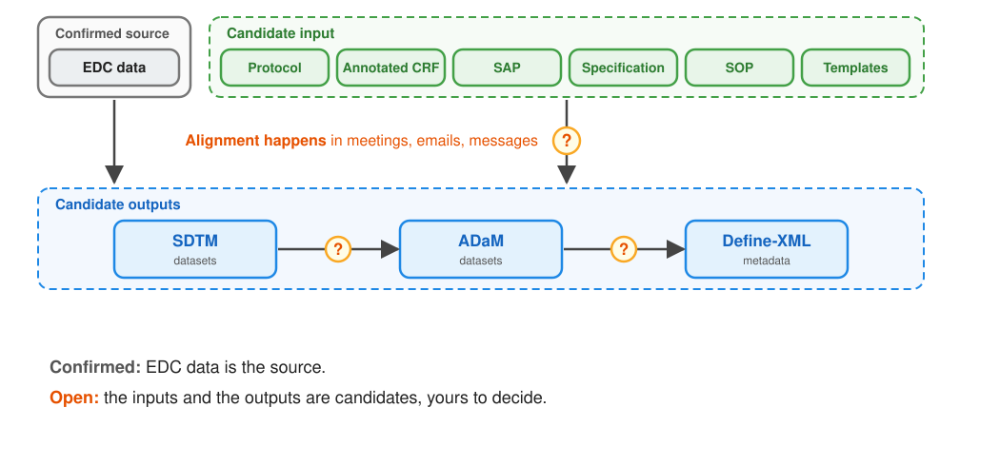

## Brainstorm: where to start building

[Discussion: 5 min]{.pill}

You will build an AI agent for this workflow. **Where do you start, and why?**

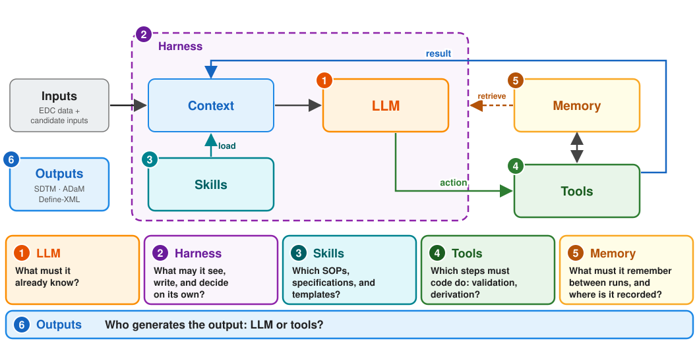

## Opinionated proposal

- As a Biometrics organization, focus on defining the workflow.
- Leverage internal and external AI infrastructure, with proper skills and tools.

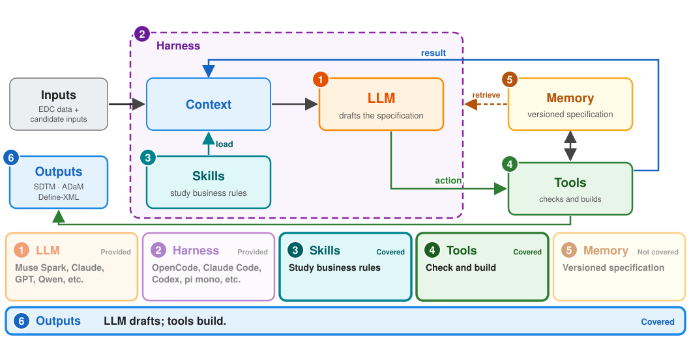

## Agentic workflow design principles

> **Root principle: trustworthy assistance.** The agent's work can be inspected,
> repeated, challenged, and reviewed.

- Plain text first. *(Inspectable artifacts)*
- Deterministic first. *(Tools and evidence)*
- One source of truth, shared by humans and AI agents. *(Explicit state)*

For CDISC data standardization, we recommend:

- Do not use the annotated CRF as an input; generate it as an output.
- Do not use a specification in Excel, Word, or PDF as an input; use a plain-text specification.

# Agentic CDISC data standardization {background-color="#385898"}

::: {.section-brief}
**You will:** see why two agents disagree on one specification, run a yamaa
specification yourself, and review one that an agent drafted.<br>
**Format:** talk, a discussion, and two hands-on exercises, about 50 minutes.
:::

## Contributors {.center}

::: {.center-body-left}
- **Peng Zhang** CIMS Global
- **Bingjun Wang** Genentech
- **Ming-chun Chen** Summit Therapeutics
- **Jingwei Xiong** Merck & Co., Inc 
- **Yilong Zhang** BBSW AI Committee
:::

## Motivation

* Two AI agents use the same specification to derive analysis datasets in clinical trials. [example](https://arena.ai/c/01a18ded-d0db-7852-b6e9-1528ddf4eb42)
* Both report completion, but their source code and outputs may differ.
* A reviewer makes non-trivial efforts to resolve the difference before signing off.

From an FDA [warning letter](https://www.fda.gov/inspections-compliance-enforcement-and-criminal-investigations/warning-letters/purolea-cosmetics-lab-722591-04022026).

> "you must review the AI-generated documents to ensure they were accurate and actually compliant..."

## One root cause

* The user prompt leaves business rules implicit, so agents must infer them.
* Business rules can differ from language defaults, e.g.:
  * [R](https://stat.ethz.ch/R-manual/R-devel/library/base/html/Round.html) and [Python](https://docs.python.org/3/library/functions.html#round) round ties to even.
  * [SAS](https://documentation.sas.com/api/docsets/lrcon/9.4/content/lrcon.pdf) compares missing numeric values as lower than non-missing values.

## Your turn: find an implicit rule {.compact}

[Discussion: 5 min]{.pill}

Take one derivation from a study you work on. Say its rule in one sentence to
your neighbor, then find the words two programmers could read differently.

::: {.roles}
| Derivation | What one sentence usually leaves open |
| --- | --- |
| **Baseline** | The last non-missing value on or before the first dose, or strictly before? Which one when two share the date? |
| **Treatment-emergent** | Onset after the first dose, or on its day? What if the onset date is partial? |
| **Analysis visit** | Which window when a visit falls on a boundary? Which record when two fall in one window? |
| **Age group** | Does `18-64` include 64? Age at screening, at randomization, or at consent? |
:::

**Where the gaps hide:** ties, missing values, partial dates, boundaries, and
language defaults such as rounding ties to even.

## Evidence: prompt completeness decides success

| Prompt tier | Python | R | opensas |
| --- | --- | --- | --- |
| Full | 99.3% (133/134) | 98.5% (132/134) | 86.6% (116/134) |
| Conventions | 35.8% (48/134) | 33.6% (45/134) | 34.3% (46/134) |
| Brief | 18.7% (25/134) | 17.9% (24/134) | 15.7% (21/134) |

::: {style="font-size: 75%;"}
Same 134 tasks, same agent. Only the prompt changed.<br>
opensas: <https://github.com/kirha-ai/opensas><br>
Agent: opencode 1.18.33. Model: opencode-go/muse-spark-1.3-contributor, 1 attempt, Oct 12 2026
:::

## Mean arterial pressure: three prompts {.map-prompts}

::: {.map-shared}
**Shared Prompt:**

- derive `ADVS` from the provided `ADVS` dataset using CDISC ADaM standards; one record per subject, visit, and parameter.
- `STUDYID, USUBJID, PARAMCD, PARAM, AVAL, VISIT, DTYPE`
- read from `/app/input`; write `/app/output/advs.csv`.
:::

::: {.map-comparison}
| Rule in the prompt | Full - **passes** | Conventions - **passes** | Brief - **fails** |
| --- | --- | --- | --- |
| MAP identifiers | `PARAMCD = "MAP"`<br>`PARAM = "Mean Arterial Pressure (mmHg)"` | Same MAP identifiers | Not stated |
| Records to add | One per subject and visit with both `SYSBP` and `DIABP`; none when either is absent or missing. | Not stated | Not stated |
| `AVAL` | Two-thirds `DIABP` plus one-third `SYSBP`;<br>not rounded. | Not rounded;<br>formula not stated. | Not stated |
| `DTYPE` | Added record: `CALCULATION`.<br>Collected records: no value. | `CALCULATION` or no value;<br>assignment not stated. | Not stated |
:::
::: {.map-takeaway}
**Brief omits both the MAP formula and the rule for adding a record.**<br>
`SYSBP` = systolic blood pressure; `DIABP` = diastolic blood pressure.<br>
<https://elong0527.github.io/yamaa/benchmark/adam-advs-map.html>
:::

::: {.notes}
The on-screen comparison summarizes the three prompts. Their complete wording, from evaluations/harbor/prompts/adam-advs-map/ (the brief prompt is derived from the full one), is below.

### Full - passes

```text
Following CDISC ADaM standards, use the provided ADVS dataset to create an ADVS
dataset with one record per subject, visit, and parameter.

The output dataset should contain the following columns in this order:
STUDYID, USUBJID, PARAMCD, PARAM, AVAL, VISIT, DTYPE

An added record with PARAMCD "MAP" and PARAM "Mean Arterial Pressure (mmHg)"
is created for each subject and visit that has both a systolic (SYSBP) and a
diastolic (DIABP) blood pressure result. On the added record, AVAL is
two-thirds of the diastolic pressure plus one-third of the systolic pressure.
AVAL on the added record is not rounded. No record is added when either
contributor is absent from the visit or its result is missing. DTYPE is
"CALCULATION" on the added record and has no value on collected records.

Read the source datasets from /app/input and save the completed dataset as
/app/output/advs.csv.
```

### Conventions - passes

```text
Following CDISC ADaM standards, use the provided ADVS dataset to create an ADVS
dataset with one record per subject, visit, and parameter.

The output dataset should contain the following columns in this order:
STUDYID, USUBJID, PARAMCD, PARAM, AVAL, VISIT, DTYPE

PARAMCD is "MAP" and PARAM is "Mean Arterial Pressure (mmHg)" on the added
record. AVAL on the added record is not rounded. DTYPE is "CALCULATION" or
has no value.

Read the source datasets from /app/input and save the completed dataset as
/app/output/advs.csv.
```

### Brief - fails

```text
Following CDISC ADaM standards, use the provided ADVS dataset to create an ADVS
dataset with one record per subject, visit, and parameter.

The output dataset should contain the following columns in this order:
STUDYID, USUBJID, PARAMCD, PARAM, AVAL, VISIT, DTYPE

Read the source datasets from /app/input and save the completed dataset as
/app/output/advs.csv.
```

:::

## Goal

- Reduce human review effort.
- Leverage organization templates.
- Capture business rules that AI agents can apply.
- Move human and AI agents collaboration at the planning stage.

## yamaa: collaboration at the planning stage

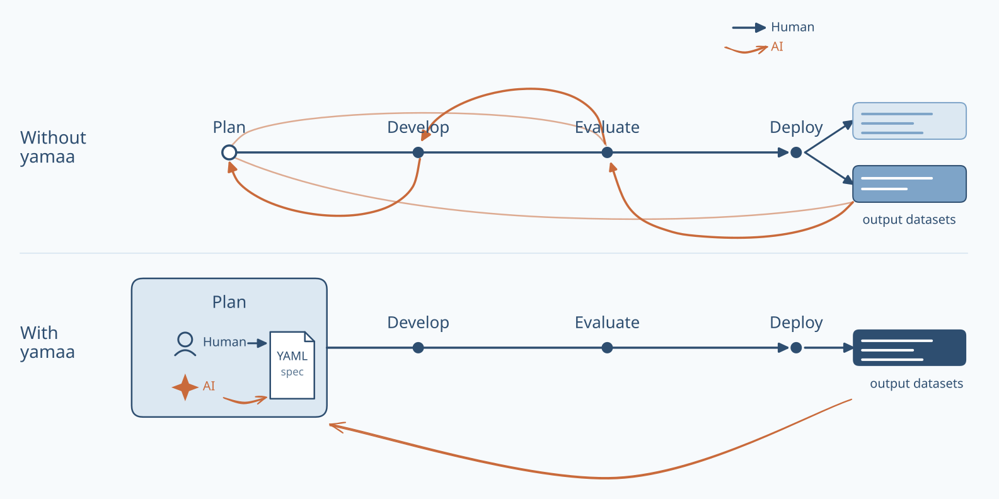

Human and AI review the specification during planning; the engine executes the agreed rules.

## yamaa: YAML specification example

```yaml
yamaa: "1.0"
type: spec
model: ADaM
domain: ADSL
keys: [STUDYID, USUBJID]
input:
  SOURCE:
    path: input/adsl.csv
    types: {HEIGHTCM: float, WEIGHTKG: float}

output:
  path: adsl.csv
  columns: [STUDYID, USUBJID, BMI]

columns:
  - {name: STUDYID, type: str, label: Study Identifier, derivation: SOURCE.STUDYID}
  - {name: USUBJID, type: str, label: Unique Subject Identifier, derivation: SOURCE.USUBJID}
  - {name: HEIGHTCM, type: float, label: Height (cm), derivation: SOURCE.HEIGHTCM}
  - {name: WEIGHTKG, type: float, label: Weight (kg), derivation: SOURCE.WEIGHTKG}
  - name: BMI
    type: float
    label: Body Mass Index (kg/m2)
    derivation: "WEIGHTKG / POWER(NULLIF(HEIGHTCM, 0) / 100, 2)"
```

## yamaa: core principle

> A yamaa specification has exactly one execution. Where it would have two,
> yamaa fails instead of choosing.

::: {.formula}
*`output_dataset = derive(input_datasets, spec)`*
:::

The design of yamaa is a contract between human and AI agents.

- **spec**: schema following closed vocabulary.
- **derive**: business rules with derivation semantics.

## yamaa: where the uncertainty lives

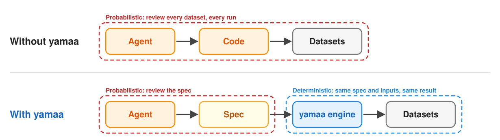

The AI agent is probabilistic, so people review the specification. The engine
that executes it is deterministic: the same specification and inputs give the
same datasets.

## yamaa: four components

| Component | Purpose | Links |
| --- | --- | --- |
| Schema | Declares the vocabulary of the specification. | [Repository](https://github.com/elong0527/yamaa/tree/main/yaml) / [Introduction](https://elong0527.github.io/yamaa/articles/schema-intro/) |
| Rules | Defines the meaning of each specification. | [Repository](https://github.com/elong0527/yamaa/tree/main/rules) / [Rules](https://elong0527.github.io/yamaa/articles/rules/) |
| Engine | Runs specifications in Python, R and CLI consistently following the rules. | [Python](https://github.com/elong0527/yamaa/tree/main/python) / [R](https://github.com/elong0527/yamaa/tree/main/R/yamaa) / [CLI](https://github.com/elong0527/yamaa/tree/main/rust/crates/yamaa-cli) |
| Benchmark | Provides runnable specification examples. | [Repository](https://github.com/elong0527/yamaa/tree/main/benchmarks) / [Dashboards](https://elong0527.github.io/yamaa/benchmark/) |

## yamaa: inheritance


Inheritance reduces duplication while keeping every resolved study specification self-contained and reviewable.
([example](https://elong0527.github.io/yamaa/benchmark/schema-inheritance.html))

## Hands-on 1: run a specification, then break it {.compact}

[Hands-on: 10 min]{.pill}

Copy the benchmark with
`mkdir -p exercise && cp -r benchmarks/adam-advs-map exercise/advs`, then run
its specification from the repository root:

::: {.panel-tabset}

### R

```r
library(yamaa)
run <- yamaa_spec("exercise/advs/spec.yaml")$run()
run$status
run$output
```

### Python

```python
import yamaa
run = yamaa.spec("exercise/advs/spec.yaml").run()
run.status
run.output
```

:::

1. **Compare** the output with `exercise/advs/expected/advs.csv`: 12 rows,
   three `MAP` records.
2. **Change the formula** in `spec.yaml` to `(DIABP_VAL + SYSBP_VAL) / 2` and
   run again: only the three `MAP` values change.
3. **Delete the `filter:` line** of the `derived_map` template and run again:
   the run fails with `row_count_failed`, since two visits with a missing
   pressure now get a `MAP` record.

**Takeaway:** same specification and inputs, same datasets; the verification
you kept catches the rule you removed.

::: {.notes}
Answer key. Step 1: the output is the expected file, with MAP 94.33333333333333
and 91.33333333333333 for subject 101 and 70 for subject 102. Step 2: the MAP
values become 101, 98 and 75; the collected records are unchanged. Step 3: the
run fails before any output with one issue,
`the row count is outside the bounds of verifications[0].row_count in 1 of
the counted groups [row_count_failed, CHECK-13]`, because subjects 103 (no
diastolic record) and 104 (missing diastolic result) each get a MAP record
with no value, 14 rows against the 12 the verification demands. Before the
next exercise, undo both edits or replace the copy with
`rm -rf exercise/advs && cp -r benchmarks/adam-advs-map exercise/advs`;
copying over the existing directory would nest the fresh copy inside it.
:::

## Hands-on 2: draft with an agent, then review {.compact}

[Hands-on: 15 min]{.pill}

Start from a fresh copy,
`rm -rf exercise/advs && cp -r benchmarks/adam-advs-map exercise/advs`, then
give OpenCode, Claude Code, or Codex this task:

::: {.prompt}
In exercise/advs/spec.yaml, add a pulse pressure record for each subject and
visit that has both a systolic and a diastolic result: PARAMCD "PP", PARAM
"Pulse Pressure (mmHg)", AVAL is the systolic minus the diastolic pressure,
not rounded, and DTYPE "CALCULATION". Keep the MAP record and every collected
record. Run the specification with yamaa and show me the output.
:::

Review the draft as the owner of the rule:

1. Is pulse pressure a new row template with the same `filter` as `MAP`, or
   did the agent edit the `MAP` template?
2. Did it raise `row_count` to 15 and extend the `no-pre-existing-target`
   assertion to `PP`?
3. Did it run the specification and read the output, or only say that it did?
4. Would you approve the specification? What would you ask for first?

**Takeaway:** the agent drafts, you review the specification rather than the
code, and the engine runs what you approved.

::: {.notes}
Answer key. A correct draft adds a third row template, `derived_pp`, with the
same `group_by`, the same `filter`, the same two `aggregate` derivations for
`SYSBP_VAL` and `DIABP_VAL`, `AVAL: "SYSBP_VAL - DIABP_VAL"`, `PARAMCD: "'PP'"`,
`PARAM: "'Pulse Pressure (mmHg)'"` and `DTYPE: "'CALCULATION'"`; it raises
`row_count` to `min: 15, max: 15` and changes the assertion to
`NOT (PARAMCD IN ('MAP', 'PP') AND DTYPE IS NULL)`. The run then succeeds with
15 rows, and the three PP records are 40 (101, BASELINE), 40 (101, WEEK 2)
and 30 (102, BASELINE). Common misses: the agent leaves `row_count` at 12 and
reports the failure as a yamaa bug, derives PP inside the MAP template, or
rounds. An agent that edits and then runs the specification shows the
workflow; one that only claims success is the point of question 3.
:::

## Open source has reached the regulators

- The R Consortium Submissions Working Group engages directly with the FDA.
  + Seven pilots demonstrate best practices for FDA submissions using R.

:::::::: {.hex-grid}
::: {.hex-item}
[](https://rconsortium.github.io/submissions-wg/pilot1.html)

**Pilot 1**

2021 -- 2022
:::

::: {.hex-item}
[](https://rconsortium.github.io/submissions-wg/pilot2.html)

**Pilot 2**

2022 -- 2024
:::

::: {.hex-item}
[](https://rconsortium.github.io/submissions-wg/pilot3.html)

**Pilot 3**

2023 -- 2024
:::

::: {.hex-item}
[](https://rconsortium.github.io/submissions-wg/pilot4.html)

**Pilot 4a**

2024 -- 2025
:::

::: {.hex-item}
[](https://rconsortium.github.io/submissions-wg/pilot4.html)

**Pilot 4b**

2024 -- 2025
:::

::: {.hex-item}
[](https://rconsortium.github.io/submissions-pilot5-website/)

**Pilot 5**

2025 -- 2026
:::

::: {.hex-item}
[](https://rconsortium.github.io/submissions-wg/pilot6.html)

**Pilot 6**

2026 -- ongoing
:::

::: {.hex-item}
[](https://rconsortium.github.io/submissions-wg/pilot7.html)

**Pilot 7**

2026 -- ongoing
:::
::::::::

## R Consortium Pilot 7: full studies

- Builds a publicly available, agentic workflow for data standardization.
  + <https://rconsortium.github.io/submissions-pilot7-synthetic-data/>
- CDISC pilots (SDTM -> ADaM)
  + CDISCPILOT01 and R Consortium Submission Pilots 3 and 5.
- OpenClinica real sample data (ODM -> SDTM -> ADaM)
  + Real sample data that tests the full data journey.
- Synthetic studies (ODM -> SDTM -> ADaM)
  + ODM XML simulated from real clinical studies.

## yamaa reproduces R Submission Pilot 5 {.perf}

- [Pilot 5 dashboard](https://rconsortium.github.io/submissions-pilot7-synthetic-data/studies/submission-pilot5/#submission-pilot5/datasets/ADSL)

::: {.perf-grid}
::: {.perf-panel}
<div class="perf-title">Real size: 254 subjects</div>

<div class="perf-group">End-to-end time, 1 core</div>
<div class="perf-row yamaa"><span class="perf-label">yamaa</span><span class="perf-track"><span class="perf-bar" style="width: 6.1%"></span></span><span class="perf-value">1.62 s</span></div>
<div class="perf-row"><span class="perf-label">R (admiral)</span><span class="perf-track"><span class="perf-bar" style="width: 100%"></span></span><span class="perf-value">26.45 s</span></div>
<div class="perf-group">Peak memory</div>
<div class="perf-row yamaa"><span class="perf-label">yamaa</span><span class="perf-track"><span class="perf-bar" style="width: 41.1%"></span></span><span class="perf-value">0.25 GB</span></div>
<div class="perf-row"><span class="perf-label">R (admiral)</span><span class="perf-track"><span class="perf-bar" style="width: 100%"></span></span><span class="perf-value">0.60 GB</span></div>
<div class="perf-callouts">
<div><div class="big-number">16x</div><div class="metric-label">faster than R</div></div>
<div><div class="big-number">2.4x</div><div class="metric-label">less memory than R</div></div>
</div>
:::

::: {.perf-panel}
<div class="perf-title">Stress test: 10x subjects (2,540)</div>

<div class="perf-group">End-to-end time, 1 core</div>
<div class="perf-row yamaa"><span class="perf-label">yamaa</span><span class="perf-track"><span class="perf-bar" style="width: 6.9%"></span></span><span class="perf-value">12.62 s</span></div>
<div class="perf-row"><span class="perf-label">R (admiral)</span><span class="perf-track"><span class="perf-bar" style="width: 100%"></span></span><span class="perf-value">181.70 s</span></div>
<div class="perf-group">Peak memory</div>
<div class="perf-row yamaa"><span class="perf-label">yamaa</span><span class="perf-track"><span class="perf-bar" style="width: 46.6%"></span></span><span class="perf-value">1.93 GB</span></div>
<div class="perf-row"><span class="perf-label">R (admiral)</span><span class="perf-track"><span class="perf-bar" style="width: 100%"></span></span><span class="perf-value">4.13 GB</span></div>
<div class="perf-callouts">
<div><div class="big-number">14x</div><div class="metric-label">faster than R</div></div>
<div><div class="big-number">2.1x</div><div class="metric-label">less memory than R</div></div>
</div>
:::
:::

## Who does what: one allocation

::: {.roles}
| Step | Statistician | Statistical programmer | AI agent |
| --- | --- | --- | --- |
| **Draft** | States each business rule: the SAP, the analysis decisions, what "baseline" means | Keeps the organization template and its conventions | Drafts the study specification from the template and the rules |
| **Review** | Reads each derivation against the SAP | Checks verifications, edge cases, and lineage | Pre-reviews the draft and lists its concerns |
| **Finalize** | Signs off | Tags the approved version | |
| **Automate** | | Schedules the runs and triages failures | None: the deterministic engine runs the approved specification |
| **Evaluate** | Designs the evaluation: decision, tasks, endpoint, rigor | Authors benchmarks and reference programs | Is the subject under test |
:::

Review moves from code to the specification, so both roles read the same
artifact.

::: callout-note
One allocation among many. Adapt it to the roles and SOPs of your organization.
:::

## Summary of the workflow

- **Extract:** enable regular EDC extraction in ODM format for each study to create a versioned source.
- **Draft:** ask an AI agent to draft the study specification from the organization or program template, adding only study differences.
- **Review:** human and AI review study derivations and verifications in yamaa, where fixes are cheap.
- **Finalize:** approve and tag the resolved specification in version control with full lineage.
- **Automate:** run the same specification on schedule in R or Python to produce identical SDTM and ADaM datasets, plus Define-XML.

> This is an iterative process while the study is ongoing. Team members and AI
> agents collaborate centrally on the version-controlled specification at the
> **planning stage**.

# AI evaluation {background-color="#385898"}

::: {.section-brief}
**You will:** design the evaluation of an AI agent as a study: the decision,
the tasks, the endpoint, the conduct, the bias, and the rigor.<br>
**Format:** talk and a discussion, about 30 minutes.
:::

## Would you sign off?

:::: {.columns}

::: {.column width="38%" .sign-off}
::: {.big-number}
133 / 134
:::
::: {.metric-label}
tasks passed with the full prompt (Python, one attempt)
:::

::: {.big-number .muted}
25 / 134
:::
::: {.metric-label}
tasks passed with the brief prompt
:::
:::

::: {.column width="62%"}
Before this result supports a decision, ask:

1. Which task failed, and would a reviewer have caught it?
2. Would the same task fail on the next run?
3. Would another model or language do better?
4. Is 99.3% good enough to submit?
:::

::::

> "you must review the AI-generated documents to ensure they were accurate and
> actually compliant..." --- FDA warning letter

Reviewing AI output is evaluating it. This section designs that evaluation the
way we design a trial.

::: {.notes}
Welcome back. Part 1 showed the same 134 SDTM and ADaM tasks at three prompt
tiers; this is the Python column. Each question returns later in the section:
the first is grader error and the gate, the second is run-to-run noise, the
third is the choose goal, and the fourth is rigor matched to risk.
:::

## An evaluation is a study

Statisticians already have the vocabulary. Read an AI evaluation as a study
protocol:

::: {.protocol}
| Protocol | Question for the evaluation | Answer in this section |
| -------- | ------------------ | ------------------ |
| Objective | What decision will the result inform? | Choose, improve, gate, or monitor |
| Intervention | What is under test? | The whole system you deploy |
| Population | Which tasks? | Benchmarks drawn from the target work |
| Endpoint | How is each task scored? | Code, an LLM judge, or people |
| Conduct | How is each run kept fair? | Harbor: hidden answers, isolated runs |
| Bias and variance | What can mislead? | Leakage, grader error, noise, saturation |
| Rigor | How much evidence is enough? | As much as the risk of the decision |
| Results | Does it work? | The evidence for yamaa so far |
:::

::: {.notes}
This table is the map for the section: each slide title starts with the
protocol element it covers.
:::

## Objective: name the decision first

:::: {.columns}

::: {.column width="44%"}
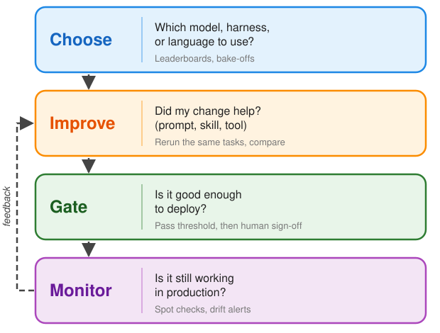
:::

::: {.column width="56%"}
::: {.goal-reading}
The prompt-tier results, read four ways:

| Goal | What the 134 tasks say |
| ---- | ---------------- |
| **Choose** | With the full prompt, Python and R are one task apart (133 vs 132); opensas passes 116. |
| **Improve** | Writing the rules into the prompt lifts Python from 25 to 133 passes. |
| **Gate** | 133 of 134, one attempt each: exact 95% CI 95.9% to 99.98% for these tasks, not for the work you deploy on. |
| **Monitor** | Not answered: a benchmark is a snapshot, not production. |
:::
:::

::::

**One table, four answers:** pick the decision before you read the number.

::: {.notes}
The 95% interval is Clopper-Pearson for 133 of 134. It treats each task as an
independent trial, so it describes these 134 tasks run once. The tasks are
authored edge cases, not a random sample of real work, so the interval does not
carry over to deployment. The brief-to-full comparison is paired: the same
tasks, agent and model, with only the prompt changed.
:::

## Intervention: the system you deploy

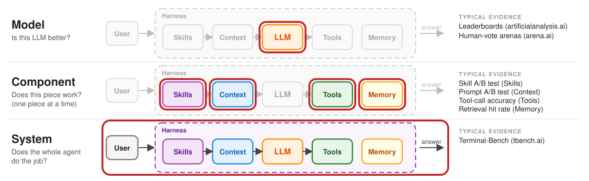

**Evaluate what you deploy: the whole system.** A trial tests the drug product
as patients take it, not the molecule alone; likewise, a top leaderboard model
does not guarantee a working workflow.

## Population: what is a benchmark?

> A benchmark is a fixed task with an independently authored answer, the
> reference standard, so an agent's work is measured rather than judged by eye.

| Part | What it is | In yamaa |
| ----- | -------- | ----------- |
| **Task** | The request the agent receives | A prompt at one of three tiers: full, conventions, or brief |
| **Inputs** | The data the agent may read | Input datasets in `/app/input` |
| **Expected output** | The reference standard, authored independently | `benchmarks/<name>/expected/`, never regenerated from an implementation |
| **Grader** | The rule that decides pass or fail | Compares every dataset cell by cell, then reruns the program |

Like a trial population, the tasks should look like the work the agent will do.

## Population: the yamaa benchmarks

:::: {.columns}
::: {.column width="48%"}
::: {.big-number}
~ 600
:::
::: {.metric-label}
runnable benchmarks
:::
:::

::: {.column width="48%"}
::: {.big-number}
3
:::
::: {.metric-label}
execution interfaces (Python, R, CLI)
:::
:::
::::

- [Explore all benchmarks](https://elong0527.github.io/yamaa/benchmark/).
  The Harbor results in this deck use 134 SDTM and ADaM tasks built from them.

<iframe class="benchmark-embed r-stretch" src="https://elong0527.github.io/yamaa/benchmark/adam-adsl-age-group.html" title="Age Groups benchmark dashboard"></iframe>

Scroll inside the frame to explore the spec, inputs, and golden output.

## Endpoint: how each task is scored

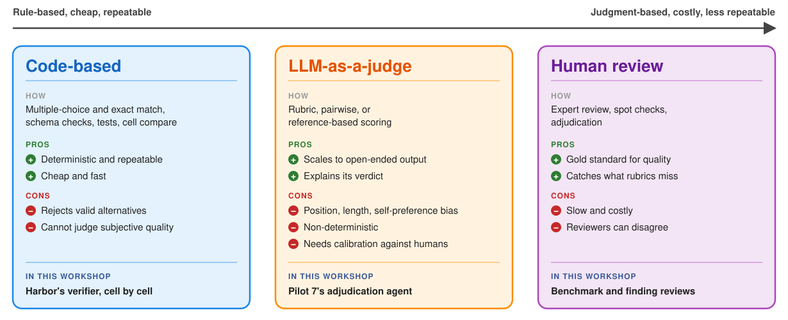

**Mix them:** code where the truth is checkable, an LLM judge to scale the
rest, and people to calibrate and sign off. The case studies use all three.

## Conduct: Harbor runs the agent

[Harbor](https://github.com/harbor-framework/harbor) runs an agent and a
verifier in separate containers and publishes each job to
[Harbor Hub](https://hub.harborframework.com/jobs?access=all&owner_org=yamaa).

::: {.flow .flow-5}
::: {.flow-step}
Task
[The prompt and the input datasets]{.small}
:::
::: {.flow-step}
Agent
[OpenCode and a model; only the model API is reachable]{.small}
:::
::: {.flow-step}
Program
[`result.R`, `result.py`, or `result.sas`]{.small}
:::
::: {.flow-step}
Verifier
[No network; compares with expected data and reruns]{.small}
:::
::: {.flow-step}
Harbor Hub
[Jobs, trials, trajectories, and leaderboards]{.small}
:::
:::

- Each benchmark becomes a Harbor task at each prompt tier, built for R and
  Python, and for opensas where its runtime supports the benchmark.
- Join the yamaa organization on Harbor Hub to explore the jobs:
  [invitation link](https://hub.harborframework.com/invite/7chJ24hLaint4KnmK5VSTnW-Sow1D2yc).

## Conduct: how Harbor grades a task

- **Hidden:** specifications, expected data, and reference programs stay out
  of the agent's container.
- **Exact:** integers match exactly, other numbers within a relative 1e-9, and
  text exactly.
- **Reproduced:** the program must rebuild every dataset from a clean output
  directory.
- **Held out:** reruns drop selected subjects and change identifiers, ages,
  measurements, and dates, which catches many hard-coded answers.
- **Policy:** each track uses only its own language; web tools and other
  runtimes fail the task.

> Reward is 1 only when every check passes. Row and cell accuracy are
> diagnostics, not the decision.

## Bias and variance: what can mislead you

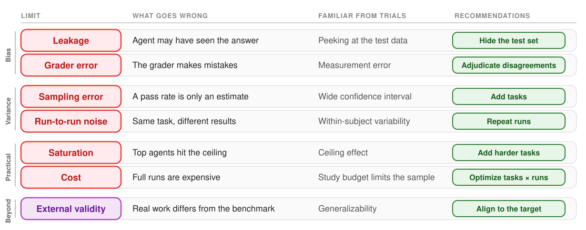

**More data shrinks variance, not bias.** Harbor's hidden answers and held-out
reruns target leakage; human review of the expected output targets grader error.

## Discussion: can you trust 133/134?

[Discussion: 5 min]{.pill}

**With your neighbor:** pick the two limits that matter most for this result, and
the cheapest way to address each.

- 133 of 134 tasks pass: Python, full prompt, one model, one attempt, October 2026.
- The exact 95% confidence interval for these 134 tasks is 95.9% to 99.98%.
- The benchmarks and their expected outputs are public on GitHub.
- Each task isolates one derivation on a fixture of about 20 rows.
- People have approved 3 of the 199 SDTM, SEND, and ADaM benchmarks so far.

::: {.notes}
Points to draw out:

- Sampling error: the interval treats the 134 tasks as independent trials and
  describes these tasks only. They are authored edge cases, not a random sample
  of real work, so no interval from them carries over to deployment. That gap
  is external validity, which more tasks of the same kind will not close.
- Run-to-run noise: one attempt per task; repeated runs show whether the same
  task fails again.
- Saturation: the full tier sits at the ceiling and cannot separate strong
  agents; the conventions and brief tiers can.
- Leakage: public benchmarks may be in a model's training data. Hidden answers
  stop lookup during the run, and held-out reruns catch hard-coded answers, but
  neither rules out memorized rules.
- External validity: small fixtures are not full studies; the retrospective
  Pilot 7 studies on the results slide address this.
- Grader error: the expected output is truth only after human review, which is
  the second case study.
:::

## Rigor: match the evidence to the risk

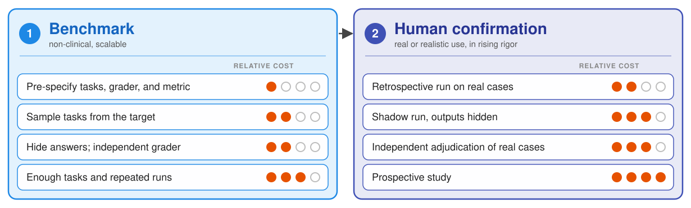

**Match the rigor to the risk:** the more a decision depends on the AI output,
and the costlier a wrong one, the further an evaluation goes: down the benchmark
column, then down the human column. In both parts, report every pre-specified
result, pin versions, and keep every log.

::: {.sources}
The two-part design is adapted from the FDA CDRH
[discussion paper](https://www.fda.gov/media/194242/download) on generative
AI-enabled devices; see also the FDA
[draft guidance on AI](https://www.fda.gov/regulatory-information/search-fda-guidance-documents/considerations-use-artificial-intelligence-support-regulatory-decision-making-drug-and-biological)
for drugs.
:::

## Results: the evidence for yamaa so far

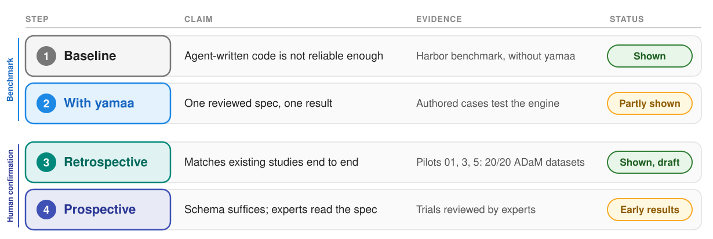

Benchmarks carry the first two claims; real studies test the last two, where
draft and early results suggest the schema is sufficient without many custom
functions and experts can read the specification with help from AI.

::: {.notes}
Bridge to the case studies: they open up the benchmark, showing how one is
created, how people finalize its truth, and how an agent is assessed with it.

The first two rows are the two rows of the "where the uncertainty lives"
diagram: agent-written code, then a reviewed specification run by a
deterministic engine.
:::

# Case study: creating a benchmark for ADaM derivation {background-color="#385898"}

::: {.section-brief}
**You will:** take one benchmark apart and list what makes it a fair test.<br>
**Format:** walk-through, about 10 minutes.
:::

## Anatomy of a benchmark

[Open adam-advs-map: mean arterial pressure](https://elong0527.github.io/yamaa/benchmark/adam-advs-map.html){.try-it}

| File | Role |
| --- | --- |
| `README.md` | The business rule in plain language |
| `spec.yaml` | The yamaa specification that derives it |
| `input/advs.csv`, `expected/advs.csv` | Four subjects and the independently authored answer |
| `benchmark.yaml` | Review concerns: pressures from the same visit, a visit with only systolic, a missing diastolic, and an unrounded MAP (94.33333333333333) |
| Harbor `prompts/adam-advs-map/` | The full and conventions prompts; the brief prompt is derived from the full one |
| Harbor `solutions/adam-advs-map/` | Independent reference programs in R, Python, and opensas |

## Mean arterial pressure: three prompts {#example-mean-arterial-pressure-the-three-prompts .map-prompts}

::: {.map-shared}
**Shared Prompt:**

- derive `ADVS` from the provided `ADVS` dataset using CDISC ADaM standards; one record per subject, visit, and parameter.
- `STUDYID, USUBJID, PARAMCD, PARAM, AVAL, VISIT, DTYPE`
- read from `/app/input`; write `/app/output/advs.csv`.
:::

::: {.map-comparison}
| Rule in the prompt | Full - **passes** | Conventions - **passes** | Brief - **fails** |
| --- | --- | --- | --- |
| MAP identifiers | `PARAMCD = "MAP"`<br>`PARAM = "Mean Arterial Pressure (mmHg)"` | Same MAP identifiers | Not stated |
| Records to add | One per subject and visit with both `SYSBP` and `DIABP`; none when either is absent or missing. | Not stated | Not stated |
| `AVAL` | Two-thirds `DIABP` plus one-third `SYSBP`;<br>not rounded. | Not rounded;<br>formula not stated. | Not stated |
| `DTYPE` | Added record: `CALCULATION`.<br>Collected records: no value. | `CALCULATION` or no value;<br>assignment not stated. | Not stated |
:::
::: {.map-takeaway}
**Brief omits both the MAP formula and the rule for adding a record.**<br>
`SYSBP` = systolic blood pressure; `DIABP` = diastolic blood pressure.<br>
<https://elong0527.github.io/yamaa/benchmark/adam-advs-map.html>
:::

## Writing a fair benchmark

1. Author the expected output independently; never regenerate it from an
   implementation.
2. Write prompts without the expected data; solvers see only the prompt and
   the inputs.
3. Reproduce the expected output with independent reference programs in each
   language.
4. Before spending model tokens, check that the reference passes and an empty
   solution fails.
5. Audit for shortcuts and leaks, and never tune a prompt to raise the pass
   rate.

> The goal is a fair test of the agent, not a high score.

# Case study: review and finalize a benchmark {background-color="#385898"}

::: {.section-brief}
**You will:** review a yamaa benchmark and a Pilot 7 finding, and see how each
is finalized.<br>
**Format:** two hands-on reviews, about 15 minutes.
:::

## Human review finalizes the truth

An AI-assisted draft is not truth until people who do the work confirm it.
Both projects collect reviews from a static page as public GitHub Discussions.

| | yamaa benchmarks | R Consortium Pilot 7 |
| --- | --- | --- |
| **What is reviewed** | Each SDTM, SEND, and ADaM benchmark: task, inputs, and expected output | AI-reported findings: Define-XML against the reproduced yamaa specification and the ADaM data |
| **Reviewer decides** | Agree or Disagree on the task, the inputs, and three AI-assisted concerns | Agree, Disagree, or Need clarification; Critical, Not critical, or Unsure |
| **Finalized when** | Two reviewers approve, nobody disagrees, and the coordinator confirms the reviewers | A reviewed publication record includes, clarifies, or excludes each finding |
| **Start here** | [Benchmark review](https://elong0527.github.io/yamaa/benchmark/review/) | [Review guide](https://rconsortium.github.io/submissions-pilot7-synthetic-data/review/) |

## Reviewing a yamaa benchmark

[Hands-on: 10 min]{.pill}

[Start reviewing](https://elong0527.github.io/yamaa/benchmark/review/next/){.try-it}

1. Sign in to GitHub; **Start reviewing** opens the next benchmark in the
   queue.
2. Read the Summary, Inputs, and Expected output: about 5 minutes.
3. Answer Agree or Disagree for the task, the inputs, and the AI-assisted
   review of three potential concerns; explain any disagreement.
4. Select **Submit and next**, then **Start discussion** in the prefilled
   GitHub tab.
5. Select **Skip** for a benchmark you cannot judge.

> Reviews are public: use public or invented data only.

## Finalizing a yamaa benchmark

::: {.flow .flow-5}
::: {.flow-step}
Review
[Published as a GitHub Discussion]{.small}
:::
::: {.flow-step}
Disagree
[A rework issue opens automatically with the comments]{.small}
:::
::: {.flow-step}
Rework
[A pull request fixes the benchmark and closes the issue]{.small}
:::
::: {.flow-step}
Review again
[The new review replaces the reviewer's earlier one]{.small}
:::
::: {.flow-step}
Approved
[Two approvals, nobody disagrees; the coordinator confirms the reviewers]{.small}
:::
:::

Round 1 status on 2026-11-07:

:::: {.columns}
::: {.column width="25%"}
::: {.big-number}
199
:::
::: {.metric-label}
SDTM, SEND, and ADaM benchmarks
:::
:::
::: {.column width="25%"}
::: {.big-number}
3
:::
::: {.metric-label}
approved
:::
:::
::: {.column width="25%"}
::: {.big-number}
17
:::
::: {.metric-label}
in review or needing rework
:::
:::
::: {.column width="25%"}
::: {.big-number}
179
:::
::: {.metric-label}
not reviewed yet
:::
:::
::::

## Reviewing a Pilot 7 finding

[Hands-on: 5 min]{.pill}

[Open the review guide](https://rconsortium.github.io/submissions-pilot7-synthetic-data/review/){.try-it}

1. Open the Pilot 5 consistency findings and select **Start review** on a
   finding; start with **Critical finding: Yes** or **Needs review**.
2. Read **The finding**, compare the cited Define-XML item with the
   reproduced yamaa specification, and check the **Subject examples**.
3. Choose Agree, Disagree, or Need clarification, then Critical, Not
   critical, or Unsure, and explain your reasoning.
4. Select **Submit review on GitHub**, then **Start discussion**.

> A 100% reproduced ADaM dataset does not resolve a disagreement between the
> data and Define-XML.

## How a Pilot 7 finding is finalized

Agents propose, a verifier checks, and people decide.

::: {.flow .flow-5}
::: {.flow-step}
Extract
[An agent cites and quotes the documents, with probes]{.small}
:::
::: {.flow-step}
Verify
[A script checks every quote and runs every probe]{.small}
:::
::: {.flow-step}
Adjudicate
[A second agent checks each finding against the sources]{.small}
:::
::: {.flow-step}
Group
[A third agent writes plain-language issues]{.small}
:::
::: {.flow-step}
Human review
[Reviewers publish; the record includes, clarifies, or excludes]{.small}
:::
:::

- Each agent has its own context; the orchestrator does not judge findings.
- The review state is committed beside the study: claims, adjudication,
  issues, and publication decisions.

> The same AI-first pattern as the workflow section: evidence first, then a
> recorded human decision.

# Case study: assessing an agent with the benchmark {background-color="#385898"}

::: {.section-brief}
**You will:** read one agent's job on Harbor Hub and decide what a failure
means.<br>
**Format:** results and a hands-on exercise, about 15 minutes.
:::

## Muse Spark 1.3 on Harbor Hub

OpenCode 1.18.33 with `opencode-go/muse-spark-1.3-contributor`, one attempt,
October 2026: nine jobs, one for each prompt tier and language.

| Benchmark (R) | Full | Conventions | Brief |
| --- | --- | --- | --- |
| `adam-adsl-age-group` | Pass | Pass | Fail (88% of cells) |
| `adam-advs-map` | Pass | Pass | Fail (73% of cells) |
| `adam-adae-death` | Pass | Fail (80% of cells) | Fail (75% of cells) |
| `adam-adtte-dor` | Pass | Fail (97% of cells) | Fail (76% of cells) |

> A failed task can still match 97% of its cells. Partial credit locates the
> gap; the reward decides.

- A full-prompt job for one language cost $0.36 to $0.96 in model usage.

## Hands-on 3: read a job on Harbor Hub

[Hands-on: 10 min]{.pill}

1. Join the yamaa organization with the [invitation link](https://hub.harborframework.com/invite/7chJ24hLaint4KnmK5VSTnW-Sow1D2yc).
2. Open the [yamaa jobs](https://hub.harborframework.com/jobs?access=all&owner_org=yamaa).
3. Pick a brief-prompt failure and open its trial: the prompt, the
   trajectory, the program, and the verifier report.
4. Decide whether it is a model failure, a rule missing from the prompt, or a
   defect in the task.
5. Compare the same task under the full prompt.

> Integrity before pass rate: a defect found in a benchmark is a finding, too.

## Takeaways

- Define the workflow, reuse AI infrastructure, and invest in skills and tools.
- Make a plain-text specification the single source of truth for humans and AI agents.
- Evaluate like a study: measure the whole system with benchmarks, let people
  review the truth, and match the rigor to the risk.

## Keep going after the course

- **Review a benchmark** in five minutes:
  [Start reviewing](https://elong0527.github.io/yamaa/benchmark/review/next/).
  Each public review helps finalize the truth that agents are measured against.
- **Join R Consortium Pilot 7:** the
  [working group](https://rconsortium.github.io/submissions-wg/pilot7.html)
  and its
  [review guide](https://rconsortium.github.io/submissions-pilot7-synthetic-data/review/).
- **Repeat the hands-on exercises** on a public study: the Codespace link
  keeps working, and the
  [Pilot 7 synthetic data](https://github.com/RConsortium/submissions-pilot7-synthetic-data)
  holds complete SDTM and ADaM packages.
- **Before adopting an agent,** write down the decision, the tasks, and the
  endpoint, then run it on the public benchmarks through
  [Harbor Hub](https://hub.harborframework.com/jobs?access=all&owner_org=yamaa)
  or on benchmarks of your own.

## References

- **yamaa:** [repository](https://github.com/elong0527/yamaa),
  [documentation](https://elong0527.github.io/yamaa/),
  [R, Python, and command-line API](https://elong0527.github.io/yamaa/articles/api/),
  and [benchmarks](https://elong0527.github.io/yamaa/benchmark/).
- **Harbor:** the [framework](https://github.com/harbor-framework/harbor) and
  [Harbor Hub](https://hub.harborframework.com/jobs?access=all&owner_org=yamaa).
- **R Consortium:** the
  [Submissions Working Group](https://rconsortium.github.io/submissions-wg/)
  and the
  [Pilot 7 synthetic data](https://rconsortium.github.io/submissions-pilot7-synthetic-data/).
- **FDA:** the
  [draft guidance on AI to support regulatory decision-making](https://www.fda.gov/regulatory-information/search-fda-guidance-documents/considerations-use-artificial-intelligence-support-regulatory-decision-making-drug-and-biological)
  and the CDRH [discussion paper](https://www.fda.gov/media/194242/download)
  on generative AI-enabled devices.
- **These slides:**
  <https://elong0527.github.io/yamaa/slides/yamaa-asa-boston-2026-11-12/>

## Questions {background-color="#385898" .center}

::: {.section-brief}
Thank you. Post your questions in the group chat, or open an issue on
[github.com/elong0527/yamaa](https://github.com/elong0527/yamaa/issues).
:::
