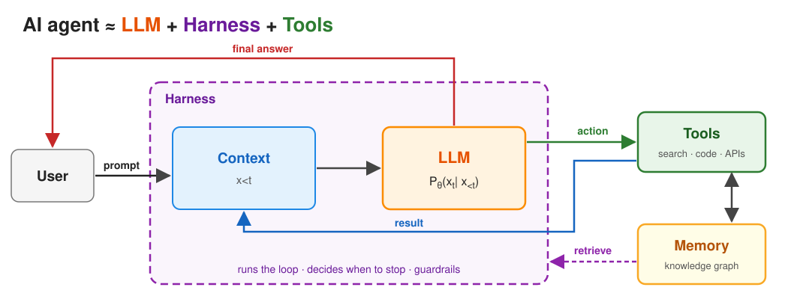
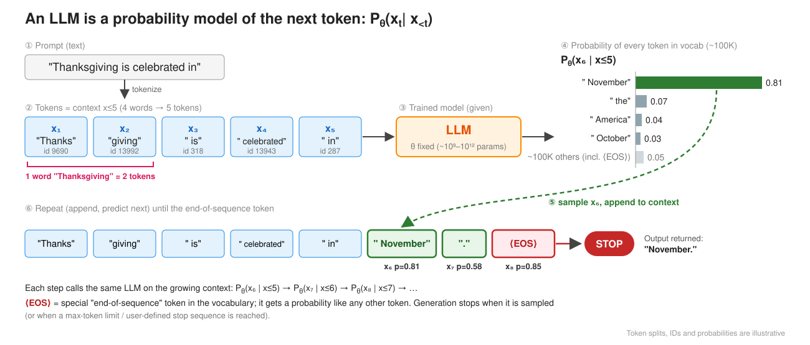
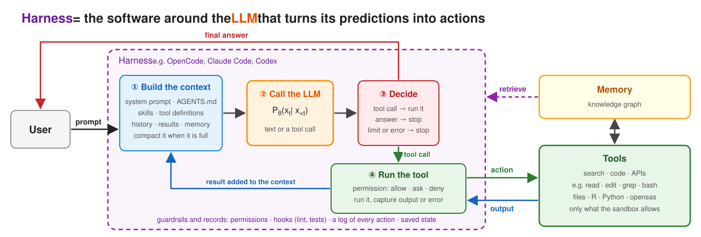
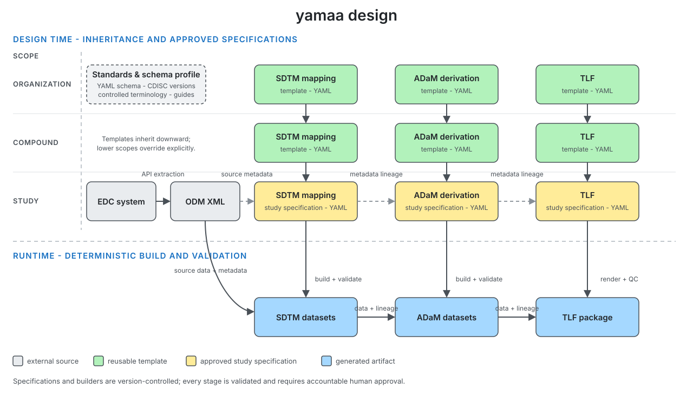

# Welcome {background-color="#385898"}

## Outline

The workshop has three parts:

1. **An AI-first workflow for CDISC data standardization (Yilong)**\
   How to design and implement an AI-first workflow, with CDISC data
   standardization as the example.

2. **Language models and agents for statistical programming (Jimeng)**\
   Strategies that improve AI agents beyond skills and tools.

3. **Case study: benchmarks and AI evaluation (Jimeng and Yilong)**\
   Hands-on case studies in evaluating AI agents and creating benchmarks.

## Disclaimer

The views and opinions expressed in this presentation are those of the
individual presenters. They do not represent those of their affiliated
organizations or institutions.

## Training objectives

By the end of the workshop, you will be able to:

* Design and implement agentic workflows for clinical trial development.
* Identify where the performance of an AI agent can be improved.
* Design and build benchmarks that assess AI agents.

::: callout-note
Toolchains, processes, and formats differ across organizations.
This workshop shows one common way to handle them.
:::

## Preparation

This workshop assumes you are familiar with the clinical development
lifecycle and CDISC standards, and that you have R programming experience.

A preconfigured GitHub Codespace is ready for the workshop:

- [{.codespaces-badge}](https://codespaces.new/elong0527/yamaa)
  + R, Python
  + OpenCode, Claude Code, Codex

- Start [OpenCode](https://opencode.ai/) and configure a model provider
  + Select `opencode-go/muse-spark-1.3-contributor`.
  + Keep API keys in your personal Codespaces secrets, never in the repository.
  + Or sign in to the preinstalled [Claude Code](https://code.claude.com/docs/en/quickstart)
    or [Codex](https://learn.chatgpt.com/docs/codex/cli).

## Resources

* During the workshop, we will use [yamaa](https://github.com/elong0527/yamaa)
  and the [R Consortium Pilot 7 project](https://github.com/RConsortium/submissions-pilot7-synthetic-data).
   * Project links will be shared in the chat.
   * Post your questions in the group chat.

# AI Agents {background-color="#385898"}


## Example: arena.ai

[Try it at arena.ai/agent](https://arena.ai/agent){.try-it}

:::: {.columns}

::: {.column width="50%"}
::: {.prompt}
Use the Pilot 5 ADSL dataset to generate a baseline characteristics table
using R and gtsummary.

Data: <https://github.com/RConsortium/submissions-pilot7-synthetic-data/tree/main/submission-pilot5/data/adam>
:::
:::

::: {.column width="50%"}
To finish, the agent has to:

1. Find `adsl.parquet` in the folder.
2. Read it in R.
3. Pick the population, arms, and grouping variables.
4. Build the table with gtsummary.
5. Return the table and its code.
:::

::::

**What to check:** the prompt never names the population, variables, or
statistics, so the agent has to guess them. Do they match your table shell?

## Example: Muse

[Try it at muse.ai](https://muse.ai){.try-it}

:::: {.columns}

::: {.column width="60%"}
Muse is a personal agent from Meta. "Give Muse a goal or task and it handles
the rest": sort email, book a dinner, or fill out a form.

Muse also helps me maintain open-source projects in the background:

- Identify project gaps from published PHUSE papers.
- Bring new benchmark ideas for CDISC standardization.
:::

::: {.column width="40%"}
{fig-alt="Muse, a soft beige character wearing headphones, works on a laptop at a desk beside a plant and a phone."}
:::

::::

::: {.notes}
Source: Muse, a personal agent from Meta, https://muse.ai.

The parts of an agent in Muse: tools are connected apps such as email and
calendar, a full browser, and new tools it builds when one is missing; the
environment is a persistent, isolated Linux computer in the cloud; memory is
the long-term goals it keeps track of; human checkpoints are the actions you
approve, such as sending an email or making a purchase.
:::

## What is an AI agent?

{fig-alt="An AI agent is an LLM plus a harness plus tools. The user's prompt enters the context inside the harness; the LLM reads the context and either takes an action with a tool, whose result returns to the context, or gives the final answer to the user. Tools can read from and write to memory, which the harness can retrieve."}

## What is a large language model?

{fig-alt="An LLM tokenizes a prompt, predicts a probability for every possible next token, samples one, appends it to the context, and repeats until it samples the end-of-sequence token."}

An LLM only predicts the next token from its context. It cannot open a file or
run code: a harness does that and puts the results back into the context.

## What is a harness?

{fig-alt="The harness is the software around the LLM. It takes the user's prompt and, in a loop, builds the context, including retrieved memory, calls the LLM, decides what the output means, and runs any tool call under its permissions, adding the tool's output back to the context. When the LLM answers, or a limit or error stops the loop, the harness returns the final answer to the user."}

> The model is the CPU; the harness is the operating system.

# AI-first workflow {background-color="#385898"}

## A mental game

:::: {.columns}

::: {.column width="55%"}
::: {.scenario}
**Shaping an AI-Native Biometrics Group from Day 0**

**What would you do?**

You have been hired by the CMO to build a biometrics group.
:::
:::

::: {.column width="45%"}
#### Blank Slate

- No legacy systems to migrate.
- No "we've always done it this way" culture.

#### Rare Opportunity

- Build an AI-native group from scratch.
- Skip the "digital transformation" pain.
:::

::::

> *Let's brainstorm the strategy for a small- to midsize biopharma company.*

## What is AI-native?

::: {.ai-levels}
| AI-Adoption | AI-First | AI-Native |
| --- | --- | --- |
| **Adding AI to existing work** | **AI is the default starting point** | **AI is a core collaborator** |
| Using AI for specific, isolated tasks. AI supplements existing workflows but does not fundamentally change how work is done. | Using AI as the primary approach. AI is systematically integrated into some workflows. AI is the default way to start and execute tasks. | AI is inseparable from how you think and work. AI-human collaboration is designed across workflows. AI is a natural extension of execution. |
| *Example: Using ChatGPT to draft an email or summarize a document.* | *Example: Starting every analysis by prompting an AI agent before writing any code manually.* | *Example: Orchestrating multiple AI agents to handle data cleaning, analysis, reporting, and QC end-to-end.* |
:::

> **AI-native is not just about tools** --- it is a mindset shift. Every team
> member becomes an orchestrator who manages AI agents, focuses on exception
> handling, and continuously improves the system.


## Focusing on Skills and Tools

| Part | What it does | In this workshop |
| ------ | ------------------ | ------------------ |
| Environment | The files, commands, and credentials the agent can reach | Provided: GitHub Codespaces |
| Model | Predicts the next step | Provided: Muse Spark, or your agent's model |
| Harness | Builds the context, runs the loop, checks permissions | Provided: OpenCode, Claude Code, or Codex |
| **Skill** | Instructions the harness loads when a task needs them (`SKILL.md`) | **Covered:** write the study's business rules as a skill |
| **Tool** | Deterministic code the agent calls and observes | **Covered:** check and run a yamaa specification |
| Memory | Notes kept between sessions | Not covered |

> A skill tells the agent how to do the task; a tool does the exact part of it.


## Goal: AI-first workflow for CDISC data standardization

| Work | Best done by | In CDISC data standardization |
| ------------- | -------- | -------------------- |
| Interpret requirements and draft changes | AI agent | Draft the study specification from templates, the protocol, and the SAP |
| Apply exact rules and comparisons | Deterministic software | Derive SDTM and ADaM with code and compare them with benchmarks |
| Exercise judgment and accept accountability | Human | Review and approve the specification and its evidence |

> Agents execute structured work with tools; explicit rules, benchmarks, and human decisions govern it.

::: {.notes}
Source: ai4csr, AI-first workflows in Biometrics,
https://github.com/elong0527/ai4csr/blob/main/02-ai-first.qmd.
:::

## yamaa: collaboration at the planning stage

{fig-alt="Human and AI collaborate on a yamaa specification during planning."}

Human and AI review the specification during planning; the engine executes the agreed rules.

## yamaa: YAML specification example

```yaml
schema_version: "1.0"
domain: ADSL
keys: [STUDYID, USUBJID]
input:
  SOURCE: input/adsl.csv

columns:
  - name: BMI
    type: float
    label: Body Mass Index (kg/m2)
    derivation:
      compute:
        expr: "WEIGHTKG / POWER(NULLIF(HEIGHTCM, 0) / 100, 2)"

verifications:
  - unique: [STUDYID, USUBJID]
```

## yamaa: core principle

> A yamaa specification has exactly one execution. Where it would have two,
> yamaa fails instead of choosing.

::: {.formula}
*`output_dataset = derive(input_datasets, spec)`*
:::

The design of yamaa is a contract between humans and AI agents.

- **spec**: a schema with a closed vocabulary.
- **derive**: business rules with defined derivation semantics.

## yamaa: four components

| Component | Purpose | Links |
| --- | --- | --- |
| Schema | Declares the vocabulary of the specification. | [Repository](https://github.com/elong0527/yamaa/tree/main/yaml) / [Introduction](https://elong0527.github.io/yamaa/articles/schema-intro/) |
| Rules | Defines the meaning of each specification. | [Repository](https://github.com/elong0527/yamaa/tree/main/rules) / [Rules](https://elong0527.github.io/yamaa/articles/rules/) |
| Engine | Runs specifications consistently in Python, R, and the CLI, following the rules. | [Python](https://github.com/elong0527/yamaa/tree/main/python) / [R](https://github.com/elong0527/yamaa/tree/main/R/yamaa) / [CLI](https://github.com/elong0527/yamaa/tree/main/rust/crates/yamaa-cli) |
| Benchmark | Provides runnable specification examples. | [Repository](https://github.com/elong0527/yamaa/tree/main/benchmarks) / [Dashboards](https://elong0527.github.io/yamaa/benchmark/) |

## yamaa: inheritance

{fig-alt="SDTM and ADaM templates at the organization and compound levels pass down to the study's SDTM and ADaM specifications in YAML, with lower scopes overriding explicitly. From ODM XML exported by the EDC system, yamaa builds and validates the SDTM datasets, then the ADaM datasets, and generates Define-XML."}

Inheritance reduces duplication while keeping every resolved study specification self-contained and reviewable.
([example](https://elong0527.github.io/yamaa/benchmark/schema-inheritance.html))

## yamaa: benchmarks

:::: {.columns}
::: {.column width="48%"}
::: {.big-number}
~ 600
:::
::: {.metric-label}
runnable benchmarks
:::
:::

::: {.column width="48%"}
::: {.big-number}
3
:::
::: {.metric-label}
execution interfaces (Python, R, CLI)
:::
:::
::::

- [Explore all benchmarks](https://elong0527.github.io/yamaa/benchmark/).

<iframe class="benchmark-embed r-stretch" src="https://elong0527.github.io/yamaa/benchmark/adam-adsl-age-group.html" title="Age Groups benchmark dashboard"></iframe>

Scroll inside the frame to explore the spec, inputs, and golden output.

## Open source has reached the regulators

- The R Consortium Submissions Working Group engages directly with the FDA.
  + Seven pilots demonstrate best practices for FDA submissions using R.

:::::::: {.hex-grid}
::: {.hex-item}
[{fig-alt="Pilot 1 hex sticker: TLFs for R Submissions."}](https://rconsortium.github.io/submissions-wg/pilot1.html)

**Pilot 1**

2021 -- 2022
:::

::: {.hex-item}
[{fig-alt="Pilot 2 hex sticker: Shiny for R Submissions."}](https://rconsortium.github.io/submissions-wg/pilot2.html)

**Pilot 2**

2022 -- 2024
:::

::: {.hex-item}
[{fig-alt="Pilot 3 hex sticker: ADaMs for R Submissions."}](https://rconsortium.github.io/submissions-wg/pilot3.html)

**Pilot 3**

2023 -- 2024
:::

::: {.hex-item}
[{fig-alt="Pilot 4a hex sticker: WebAssembly for R Submissions."}](https://rconsortium.github.io/submissions-wg/pilot4.html)

**Pilot 4a**

2024 -- 2025
:::

::: {.hex-item}
[{fig-alt="Pilot 4b hex sticker: containers for R Submissions."}](https://rconsortium.github.io/submissions-wg/pilot4.html)

**Pilot 4b**

2024 -- 2025
:::

::: {.hex-item}
[{fig-alt="Pilot 5 hex sticker: datasetjson for R Submissions."}](https://rconsortium.github.io/submissions-pilot5-website/)

**Pilot 5**

2025 -- 2026
:::

::: {.hex-item}
[{fig-alt="Pilot 6 hex sticker: AI-driven ADaMs and TLFs for R Submissions."}](https://rconsortium.github.io/submissions-wg/pilot6.html)

**Pilot 6**

2026 -- ongoing
:::

::: {.hex-item}
[{fig-alt="Pilot 7 hex sticker: Synthetic Clinical Data."}](https://rconsortium.github.io/submissions-wg/pilot7.html)

**Pilot 7**

2026 -- ongoing
:::
::::::::

::: {.notes}
Source: R Consortium Submissions Working Group, hex stickers,
https://rconsortium.github.io/submissions-wg/#hex-stickers.
:::

## R Consortium Pilot 7: full studies

- Builds a publicly available, agentic workflow for data standardization.
  + <https://rconsortium.github.io/submissions-pilot7-synthetic-data/>
- CDISC pilots (SDTM -> ADaM)
  + CDISCPILOT01 and R Consortium Submission Pilots 3 and 5.
- OpenClinica real sample data (ODM -> SDTM -> ADaM)
  + Real sample data that tests the full data journey.
- Synthetic studies (ODM -> SDTM -> ADaM)
  + ODM XML simulated from real clinical studies.

## yamaa reproduces R Submission Pilot 5 {.perf}

- [Pilot 5 dashboard](https://rconsortium.github.io/submissions-pilot7-synthetic-data/studies/submission-pilot5/#submission-pilot5/datasets/ADSL)

::: {.perf-grid}
::: {.perf-panel}
<div class="perf-title">Real size: 254 subjects</div>

<div class="perf-group">End-to-end time, 1 core</div>
<div class="perf-row yamaa"><span class="perf-label">yamaa</span><span class="perf-track"><span class="perf-bar" style="width: 6.1%"></span></span><span class="perf-value">1.62 s</span></div>
<div class="perf-row"><span class="perf-label">R (admiral)</span><span class="perf-track"><span class="perf-bar" style="width: 100%"></span></span><span class="perf-value">26.45 s</span></div>
<div class="perf-group">Peak memory</div>
<div class="perf-row yamaa"><span class="perf-label">yamaa</span><span class="perf-track"><span class="perf-bar" style="width: 41.1%"></span></span><span class="perf-value">0.25 GB</span></div>
<div class="perf-row"><span class="perf-label">R (admiral)</span><span class="perf-track"><span class="perf-bar" style="width: 100%"></span></span><span class="perf-value">0.60 GB</span></div>
<div class="perf-callouts">
<div><div class="big-number">16×</div><div class="metric-label">faster than R</div></div>
<div><div class="big-number">2.4×</div><div class="metric-label">less memory than R</div></div>
</div>
:::

::: {.perf-panel}
<div class="perf-title">Stress test: 10× subjects (2,540)</div>

<div class="perf-group">End-to-end time, 1 core</div>
<div class="perf-row yamaa"><span class="perf-label">yamaa</span><span class="perf-track"><span class="perf-bar" style="width: 6.9%"></span></span><span class="perf-value">12.62 s</span></div>
<div class="perf-row"><span class="perf-label">R (admiral)</span><span class="perf-track"><span class="perf-bar" style="width: 100%"></span></span><span class="perf-value">181.70 s</span></div>
<div class="perf-group">Peak memory</div>
<div class="perf-row yamaa"><span class="perf-label">yamaa</span><span class="perf-track"><span class="perf-bar" style="width: 46.6%"></span></span><span class="perf-value">1.93 GB</span></div>
<div class="perf-row"><span class="perf-label">R (admiral)</span><span class="perf-track"><span class="perf-bar" style="width: 100%"></span></span><span class="perf-value">4.13 GB</span></div>
<div class="perf-callouts">
<div><div class="big-number">14×</div><div class="metric-label">faster than R</div></div>
<div><div class="big-number">2.1×</div><div class="metric-label">less memory than R</div></div>
</div>
:::
:::
