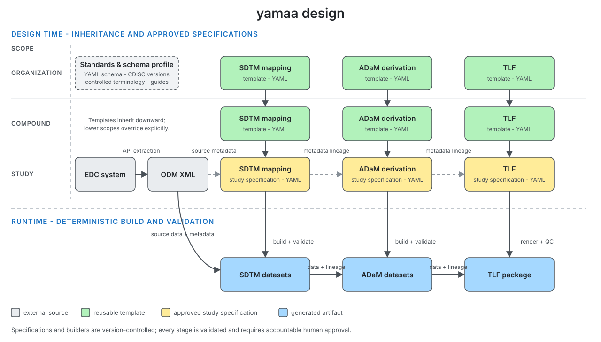

## Disclaimer

The views and opinions expressed in this presentation are those of the
individual presenter. They do not represent those of their affiliated
organizations or institutions.

## Contributors {.center}

::: {.center-body-left}
- **Peng Zhang** CIMS Global
- **Bingjun Wang** Genentech
- **Ming-chun Chen** Summit Therapeutics
- **Jingwei Xiong** Merck & Co., Inc 
- **Yilong Zhang** BBSW AI Committee
:::

## Motivation

* Two AI agents use the same specification to derive ADaM data.
* Both report completion, but their source code and outputs differ.
* A reviewer makes non-trivial efforts to resolve the difference before signing off.

From an FDA [warning letter](https://www.fda.gov/inspections-compliance-enforcement-and-criminal-investigations/warning-letters/purolea-cosmetics-lab-722591-04022026).

> "you must review the AI-generated documents to ensure they were accurate and actually compliant..."

## One root cause

* The user prompt leaves business rules implicit, so agents must infer them.
* Business rules can differ from language defaults, e.g.:
  * [R](https://stat.ethz.ch/R-manual/R-devel/library/base/html/Round.html) and [Python](https://docs.python.org/3/library/functions.html#round) round ties to even.
  * [SAS](https://documentation.sas.com/api/docsets/lrcon/9.4/content/lrcon.pdf) compares missing numeric values as lower than non-missing values.

## Evidence: prompt completeness decides success

| Prompt tier | Python | R | opensas |
| --- | --- | --- | --- |
| Full (every rule stated) | 99.3% (133/134) | 98.5% (132/134) | 86.6% (116/134) |
| Conventions (labels and value rules) | 35.8% (48/134) | 33.6% (45/134) | 34.3% (46/134) |
| Brief (columns only) | 18.7% (25/134) | 17.9% (24/134) | 15.7% (21/134) |

* Same 134 tasks, same agent. Only the prompt changed.

::: {style="font-size: 75%;"}
Agent: opencode 1.18.33. Model: opencode-go/muse-spark-1.3-contributor, 1 attempt, Oct 12 2026
:::

## Mean arterial pressure: three prompts {#example-mean-arterial-pressure-the-three-prompts .map-prompts}

::: {.map-shared}
**Shared by all prompts:** derive `ADVS` from `ADVS_RAW` using CDISC ADaM standards; one record per subject, visit, and parameter.<br>
**Columns, in order:** `STUDYID, USUBJID, PARAMCD, PARAM, AVAL, VISIT, DTYPE`<br>
**Files:** read from `/app/input`; write `/app/output/advs.csv`.
:::

::: {.map-comparison}
| Rule in the prompt | Full - **passes** | Conventions - **passes** | Brief - **fails** |
| --- | --- | --- | --- |
| MAP identifiers | `PARAMCD = "MAP"`<br>`PARAM = "Mean Arterial Pressure (mmHg)"` | Same MAP identifiers | Not stated |
| Records to add | Keep all collected records. Add one MAP per subject/visit only when both SBP and DBP results exist and are non-missing. | Not stated | Not stated |
| `AVAL` | Keep collected values.<br>MAP = (2 x DBP + SBP) / 3;<br>do not round. | MAP is not rounded;<br>formula not stated. | Not stated |
| `DTYPE` | Added MAP: `CALCULATION`.<br>Collected records: blank. | `CALCULATION` or blank;<br>assignment not stated. | Not stated |
:::
::: {.map-takeaway}
**Brief omits both the MAP formula and the rule for adding a record.**<br>
SBP = systolic blood pressure; DBP = diastolic blood pressure.<br>
<https://elong0527.github.io/yamaa/benchmark/adam-advs-map.html>
:::

::: {.notes}
The on-screen comparison summarizes the three prompts. Their complete wording is retained below.

### Full - passes

```text
Following CDISC ADaM standards, use the provided ADVS_RAW dataset to create an ADVS dataset with one record per subject per visit per parameter.

The output dataset should contain the following columns in this order:
STUDYID, USUBJID, PARAMCD, PARAM, AVAL, VISIT, DTYPE

Keep every collected record, and add one mean arterial pressure record for each subject and visit that has both a systolic and a diastolic blood pressure result. Mark it with PARAMCD "MAP" and PARAM "Mean Arterial Pressure (mmHg)".

AVAL keeps each collected result. On the added record it is the average that counts the diastolic pressure twice and the systolic pressure once, not rounded. No record is added when either contributor is absent from the visit or its result is missing.

DTYPE is CALCULATION on the added record and has no value on collected records.

Read the source datasets from /app/input and save the completed dataset as /app/output/advs.csv.
```

### Conventions - passes

```text
Following CDISC ADaM standards, use the provided ADVS_RAW dataset to create an ADVS dataset with one record per subject per visit per parameter.

The output dataset should contain the following columns in this order:
STUDYID, USUBJID, PARAMCD, PARAM, AVAL, VISIT, DTYPE

Mark a mean arterial pressure record with PARAMCD "MAP" and PARAM "Mean Arterial Pressure (mmHg)".

On a mean arterial pressure record AVAL is not rounded.

DTYPE is CALCULATION or has no value.

Read the source datasets from /app/input and save the completed dataset as /app/output/advs.csv.
```

### Brief - fails

```text
Following CDISC ADaM standards, use the provided ADVS_RAW dataset to create an ADVS dataset with one record per subject per visit per parameter.

The output dataset should contain the following columns in this order:
STUDYID, USUBJID, PARAMCD, PARAM, AVAL, VISIT, DTYPE

Read the source datasets from /app/input and save the completed dataset as /app/output/advs.csv.
```

:::

## Goal

- Reduce human review effort.
- Leverage organization templates.
- Capture business rules that AI agents can apply.
- Human and AI agents align at the planning stage.

## yamaa: YAML specification example

```yaml
schema_version: "1.0"
domain: ADSL
keys: [STUDYID, USUBJID]
input:
  SOURCE: input/adsl.csv

columns:
  - name: BMI
    type: float
    label: Body Mass Index (kg/m2)
    derivation:
      compute:
        expr: "WEIGHTKG / POWER(NULLIF(HEIGHTCM, 0) / 100, 2)"

verifications:
  - unique: [STUDYID, USUBJID]
```

## yamaa: core principle

> A yamaa specification has exactly one execution. Where it would have two,
> yamaa fails instead of choosing.

::: {.formula}
*`output_dataset = derive(input_datasets, spec)`*
:::

The design of yamaa is a contract between people and AI agents.

- **spec**: schema following closed vocabulary.
- **derive**: business rules with derivation semantics.

## yamaa: four components

| Component | Purpose | Links |
| --- | --- | --- |
| Schema | Declares the vocabulary of the specification. | [Repository](https://github.com/elong0527/yamaa/tree/main/yaml) / [Introduction](https://elong0527.github.io/yamaa/articles/schema-intro/) |
| Rules | Defines the meaning of each specification. | [Repository](https://github.com/elong0527/yamaa/tree/main/rules) / [Rules](https://elong0527.github.io/yamaa/articles/rules/) |
| Engine | Runs specifications in Python and R according to the rules. | [Python](https://github.com/elong0527/yamaa/tree/main/python) / [R](https://github.com/elong0527/yamaa/tree/main/R/yamaa) |
| Benchmark | Provides runnable specification examples. | [Repository](https://github.com/elong0527/yamaa/tree/main/benchmarks) / [Dashboards](https://elong0527.github.io/yamaa/benchmark/) |

## yamaa: inheritance



Inheritance reduces duplication while keeping every resolved study specification self-contained and reviewable.
([example](https://elong0527.github.io/yamaa/benchmark/schema-inheritance.html))

## yamaa: benchmarks

::: {.columns}
::: {.column width="48%"}
<div class="big-number">~ 600</div>
<div class="metric-label">runnable benchmarks</div>
:::

::: {.column width="48%"}
<div class="big-number">2</div>
<div class="metric-label">engines (Python, R)</div>
:::
:::

* [Explore all benchmarks](https://elong0527.github.io/yamaa/benchmark/)

<iframe class="benchmark-embed" src="https://elong0527.github.io/yamaa/benchmark/adam-adsl-age-group.html" title="Age Groups benchmark dashboard"></iframe>

Scroll inside the frame to explore the spec, inputs, and golden output.

## yamaa: full studies

* Build publicly available ground truth.
  * [https://github.com/RConsortium/submissions-pilot7-synthetic-data](https://github.com/RConsortium/submissions-pilot7-synthetic-data)
* CDISC pilots (SDTM -> ADaM)
  * cdiscpilot01 and RConsortium submission pilots 3, 5, and 6.
* OpenClinica real sample data (ODM -> SDTM -> ADaM)
  * Real sample data for testing the full data journey.
* Synthetic studies (ODM -> SDTM -> ADaM)
  * Simulate ODM XML from real clinical studies.

## Pilot 7: October sprint in one slide

What landed since the September update (selected merges):

- **Shared program templates:** ADSL, ADAE, ADLBC, ADTTE, and ADAS-Cog derivations reused across CDISCPILOT01 packages ([#154](https://github.com/RConsortium/submissions-pilot7-synthetic-data/pull/154), [#156](https://github.com/RConsortium/submissions-pilot7-synthetic-data/pull/156), [#157](https://github.com/RConsortium/submissions-pilot7-synthetic-data/pull/157), [#163](https://github.com/RConsortium/submissions-pilot7-synthetic-data/pull/163), [#164](https://github.com/RConsortium/submissions-pilot7-synthetic-data/pull/164), [#173](https://github.com/RConsortium/submissions-pilot7-synthetic-data/pull/173)).
- **Define-XML 2.0 reproduced** for submission pilots 3 and 5 ([#144](https://github.com/RConsortium/submissions-pilot7-synthetic-data/pull/144)); Pilot 01 legacy 1.0 comparison in [#148](https://github.com/RConsortium/submissions-pilot7-synthetic-data/pull/148).
- **Executable resolved specs saved** with documented-rule checks ([#167](https://github.com/RConsortium/submissions-pilot7-synthetic-data/pull/167)) - the reviewed spec is the runnable spec.
- **Synthetic studies:** KN189/KN564 SDTM, ADaM, Define-XML and review findings ([#152](https://github.com/RConsortium/submissions-pilot7-synthetic-data/pull/152), [#155](https://github.com/RConsortium/submissions-pilot7-synthetic-data/pull/155)).

## Pilot 7: review is the product

The October work converged the study dashboard on human review:

- **Start review:** per-finding trace evidence with human dispositions ([#169](https://github.com/RConsortium/submissions-pilot7-synthetic-data/pull/169), [#179](https://github.com/RConsortium/submissions-pilot7-synthetic-data/pull/179)).
- **Source documents vs YAML evidence separated** so reviewers see what the protocol said and what the spec claims ([#181](https://github.com/RConsortium/submissions-pilot7-synthetic-data/pull/181)).
- **Compare first:** side-by-side Define-XML and worksheet-tab Excel views load before source documents ([#170](https://github.com/RConsortium/submissions-pilot7-synthetic-data/pull/170), [#175](https://github.com/RConsortium/submissions-pilot7-synthetic-data/pull/175), [#176](https://github.com/RConsortium/submissions-pilot7-synthetic-data/pull/176)).
- **Automated consistency review** across the three pilot studies, grouped into reviewable issues ([#153](https://github.com/RConsortium/submissions-pilot7-synthetic-data/pull/153), [#141](https://github.com/RConsortium/submissions-pilot7-synthetic-data/pull/141)).

Open next step: submit dashboard reviews directly to GitHub ([#180](https://github.com/RConsortium/submissions-pilot7-synthetic-data/pull/180), open).

## Four separate questions for a reviewer

| Evidence | Question it answers |
| --- | --- |
| Execution | Did the specification build successfully? |
| Reference comparison | Did the output match the published dataset under this comparator? |
| Clinical review | Does the derivation express the documented study intent? |
| Metadata and conformance checks | Does the package reproduce or satisfy the required metadata contract? |

Reference agreement can coexist with a documentation conflict. Do not
describe a passing comparator as regulatory validation.

## Recommendations: ODM XML

- [CDISC ODM](https://www.cdisc.org/standards/data-exchange/odm) is an XML standard for clinical research data.
- EDC systems can export study data in ODM XML.
- Teams familiar with define.xml will recognize the ODM structure.

Learn with AI: [https://arena.ai/](https://arena.ai/)

## Recommendations: Input and Output

- Plain text is the input.
- Annotated CRF is not an input but an output.
- Excel specification is not an input but an output.
- Communication costs more than tokens.

## Summary of the workflow

- **Extract:** enable regular EDC extraction in ODM format for each study to create a versioned source.
- **Draft:** ask AI agent to draft the study spec from the organization or program template, adding only study differences.
- **Review:** human and AI review study derivations and verifications in yamaa where fixes are cheap.
- **Finalize:** approve and tag the resolved spec in version control with full lineage.
- **Automate:** run the same spec on schedule in R or Python to produce identical SDTM and ADaM plus define.xml.

> Note: this is an iterative process while the study is ongoing. Team members and AI collaborate centrally on the version controlled specification.

## How to contribute

* RConsortium / BBSW
  - [Submission working group Pilot7](https://rconsortium.github.io/submissions-wg/pilot7.html)
  - [Review guide, now focused on Pilot 5](https://github.com/RConsortium/submissions-pilot7-synthetic-data/pull/171) - review one study, co-authorship opportunity
  - [Slack channel / Regular Meetings](https://rconsortium.github.io/submissions-wg/join.html)

* Public benchmarks
  - **Review a benchmark**: inspect the specification and golden output
  - **Add comments**: question assumptions, clarity, and conformance
  - **File issues**: record anything ambiguous or incorrect
  - **Open pull requests**: contribute fixes and new benchmarks

## Benchmark to deployment

- **Benchmarks** help assess an AI agent before adoption.
- **Deployment** also requires onboarding the agent to a specific organization environment.
Collaborating with [keiji.ai](https://keiji.ai/) to test synthetic clinical trial data.

[https://github.com/RConsortium/submissions-pilot7-synthetic-data](https://github.com/RConsortium/submissions-pilot7-synthetic-data)

## Reference

- **Repository:** [github.com/elong0527/yamaa](https://github.com/elong0527/yamaa)
- **Documentation:** [elong0527.github.io/yamaa](https://elong0527.github.io/yamaa/)
- **Benchmarks:** [elong0527.github.io/yamaa/benchmark](https://elong0527.github.io/yamaa/benchmark/)